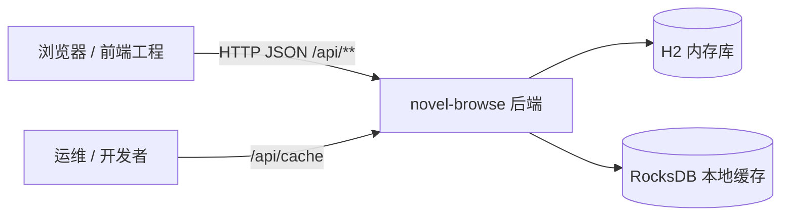
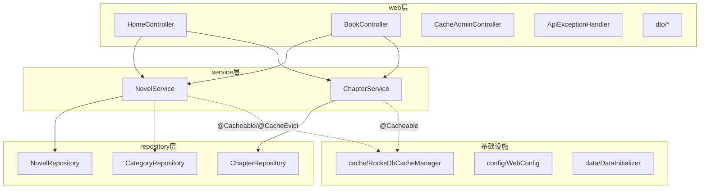
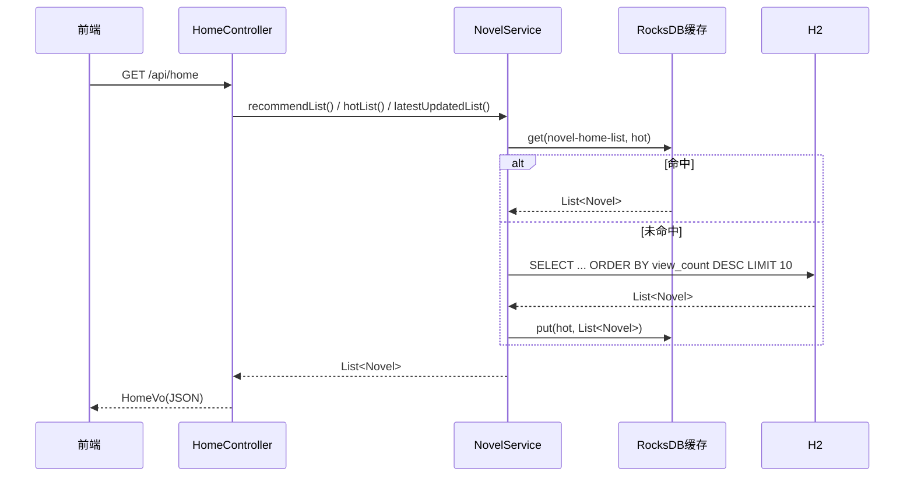

# 01 架构设计

## 1. 系统上下文

- **前端**：任意 Web 框架（Vue / React 等），仅通过 `/api/**` 消费接口，可独立开发部署（Vite 代理或跨域直连）。
- **后端**：本项目，职责为书目检索、目录、章节阅读与热点数据缓存。
- **存储**：H2 内存关系库（演示 / 轻量场景）；**缓存**：RocksDB（嵌入式）。

## 2. 分层架构

分层职责：

| 层 | 职责 | 约束 |
| --- | --- | --- |
| `web` | HTTP 入口、参数绑定、实体转 DTO、异常转 JSON | 不写业务规则，不透出 JPA 实体 |
| `service` | 业务用例、事务边界、缓存注解声明 | 返回领域对象，缓存在此层声明 |
| `repository` | Spring Data JPA 查询 | 只做数据访问 |
| `domain` | 实体与领域常量 | 可序列化（缓存需要） |
| `cache` | RocksDB 缓存实现 | 对接 Spring Cache 抽象，对业务透明 |
| `config` / `data` | 跨域配置、演示数据初始化 | 仅启动期逻辑 |

## 3. 技术选型

| 领域 | 选型 | 理由 | 备选 |
| --- | --- | --- | --- |
| 语言 / 运行时 | Java 21 | LTS 版本 | Java 17 |
| 框架 | Spring Boot 4.1.1（当前最新 GA） | 生态完整、自动装配齐备 | Quarkus / Micronaut |
| Web | spring-boot-starter-web（Spring MVC） | 同步阻塞模型足够、依赖最少 | WebFlux |
| ORM | Spring Data JPA + Hibernate 7 | 快速建模，查询语义清晰 | MyBatis / jOOQ |
| 数据库 | H2 内存库 | 零外部依赖，适合演示与测试 | PostgreSQL / MySQL |
| 缓存 | RocksDB（rocksdbjni 11.1.2） | 用户指定；嵌入式、无需独立服务 | Redis |
| 序列化 | JDK 原生序列化 | 零依赖、类型保真 | Kryo / Jackson |
| 构建 | Gradle 9.6.0 + Wrapper | 用户指定；增量构建快 | Maven |
| 依赖源 | 腾讯云镜像 + 官方源兜底 | 国内网络可达性与完整性兼顾 | 仅官方源 |

## 4. 关键架构决策（ADR 摘要）

| 编号 | 决策 | 备选方案 | 结论原因 |
| --- | --- | --- | --- |
| ADR-1 | 前后端分离，后端不保留页面代码 | 服务端渲染 | 前端可独立迭代，一套 API 多端复用 |
| ADR-2 | 缓存在 service 层声明 | controller 层缓存字符串 | 缓存领域对象，命中率高且与传输格式解耦 |
| ADR-3 | 所有缓存共享一个 RocksDB 实例，key 前缀隔离 | 每个缓存一个 DB / ColumnFamily | 实例与文件句柄更少，实现简单 |
| ADR-4 | 缓存容忍降级（写入/反序列化失败按未命中） | 异常上抛 | 缓存是加速手段，不应导致业务不可用 |
| ADR-5 | `clean-on-start=true` | 复用磁盘缓存 | 内存库重启会重新生成 ID，避免读到上一轮脏数据 |
| ADR-6 | 统一错误体 `ApiError` + `@RestControllerAdvice` | 各 controller 自行 try-catch | 错误语义一致，前端处理统一 |

## 5. 典型请求链路

### 5.1 首页聚合

### 5.2 书籍详情（含一次写操作）

1. `GET /api/novels/{id}` → `NovelService.viewDetail(id)`
2. 方法上标注 `@CacheEvict(novel-detail, key=#id)`：自增点击数后失效详情缓存
3. 同时查询章节列表（`novel-chapter-list` 缓存）与同类推荐（`novel-home-list` 缓存）

> 说明：`viewDetail` 内部调用 `detail(id)` 属于类内自调用，不经过缓存切面；`detail` 上的 `@Cacheable` 只对外部调用者生效，语义上依然安全。

## 6. 非功能设计要点

| 维度 | 设计 |
| --- | --- |
| 性能 | 热门列表、详情、章节均走 RocksDB 本地读，热点几乎无 DB 压力 |
| 可用 | 缓存异常降级为未命中；单进程内嵌，无外部依赖故障面 |
| 安全 | 当前无鉴权；开放 `app.cors.*` 便于前端联调，生产需收敛来源域名 |
| 可观测 | `GET /api/cache` 提供命中率与条目数；日志分级在 `application.yml` |
| 可扩展 | 嵌入式缓存不适合多实例共享；水平扩容时应切换 Redis（见 [05 文档](05-构建部署与配置.md)） |
