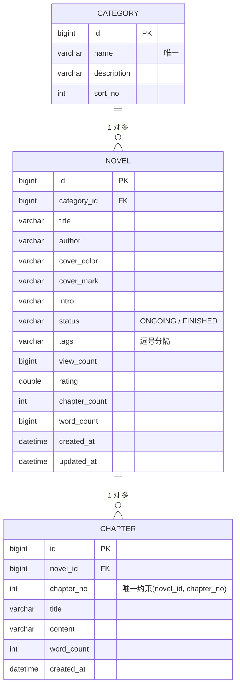

# 02 领域模型与数据设计

## 1. 领域对象

三个核心实体：`Category`（分类）、`Novel`（书目）、`Chapter`（章节）。

## 2. 表结构对照

| 实体              | 表名               | 关键索引 / 约束                                                                             |
|-------------------|--------------------|---------------------------------------------------------------------------------------------|
| `Category`        | `nb_category`      | `name` 唯一                                                                                 |
| `Novel`           | `nb_novel`         | 主键 `id`；`idx_novel_category(category_id)`；`idx_novel_views(view_count)`                 |
| `Chapter`         | `nb_chapter`       | 主键 `id`；唯一约束 `uk_chapter_novel_no(novel_id, chapter_no)`                             |
| `User`            | `nb_user`          | 主键 `id`；`username` 唯一；`email` 唯一                                                    |
| `UserSession`     | `nb_user_session`  | 主键 `id`；`token` 唯一；`idx_session_user(user_id)`；`idx_session_expires(expires_at)`     |
| `UserLike`        | `nb_user_like`     | 主键 `id`；唯一约束 `uk_like_user_novel(user_id, novel_id)`                                 |
| `UserFavorite`    | `nb_user_favorite` | 主键 `id`；唯一约束 `uk_favorite_user_novel(user_id, novel_id)`                             |
| `ReadingProgress` | `nb_read_progress` | 主键 `id`；唯一约束 `uk_progress_user_novel(user_id, novel_id)`                             |
| `Review`          | `nb_review`        | 主键 `id`；唯一约束 `uk_review_user_novel(user_id, novel_id)`；`idx_review_novel(novel_id)` |

建表由 Hibernate `ddl-auto=update` 自动完成，无需手工 DDL；切换外部库时建议改用 Flyway / Liquibase 管理脚本（见 [05 文档](05-构建部署与配置.md)）。

## 3. 字段字典

### nb_category

| 字段 | 类型 | 说明 |
| --- | --- | --- |
| id | bigint | 主键，自增 |
| name | varchar(32) | 分类名，唯一 |
| description | varchar(128) | 分类简介 |
| sort_no | int | 排序号，升序排列用于导航 |

### nb_novel

| 字段          | 类型          | 说明                                                                                                 |
|---------------|---------------|------------------------------------------------------------------------------------------------------|
| id            | bigint        | 主键，自增                                                                                           |
| title         | varchar(128)  | 书名                                                                                                 |
| author        | varchar(64)   | 作者                                                                                                 |
| category_id   | bigint        | 外键 → `nb_category.id`（`EAGER` 加载）                                                              |
| cover_color   | varchar(128)  | 封面 CSS 渐变值，避免依赖外部图片                                                                    |
| cover_mark    | varchar(8)    | 封面占位字符（如 剑 / 案）                                                                           |
| intro         | varchar(2000) | 简介，含换行                                                                                         |
| status        | varchar(16)   | `ONGOING`（连载）/ `FINISHED`（完结）                                                                |
| tags          | varchar(128)  | 逗号分隔标签                                                                                         |
| view_count    | bigint        | 点击数，详情页自增                                                                                   |
| rating        | double        | 评分，0~10，一位小数；有读者评分时由星均分（1-5）×2 回写                                             |
| rating_count  | int           | 参与评分的人数，与 `rating` 一起回写                                                                 |
| like_count    | int           | 点赞数，随点赞 / 取消点赞回写                                                                        |
| chapter_count | int           | 章节数，初始化时写入并随章节新增维护                                                                 |
| word_count    | bigint        | 总字数，初始化时按各章字数累计                                                                       |
| created_at    | datetime      | 创建时间                                                                                             |
| updated_at    | datetime      | 最近更新时间，「最近更新」列表按此排序                                                               |
| cover_image   | varchar(255)  | 封面图文件名（位于 `app.cover.dir`，由 EPUB 导入时提取），为空则用 `cover_color` + `cover_mark` 兜底 |
| source_file   | varchar(255)  | 来源 EPUB 相对路径（`分类目录/文件名`，位于 `app.upload.dir` 下）                                    |
| source_hash   | varchar(64)   | 来源 EPUB 内容 SHA-256，用于上传去重与启动扫描去重                                                   |

派生属性（`@Transient`，不入库）：`statusText`（连载 / 完结）、`tagList`（标签数组）。

### nb_chapter

| 字段 | 类型 | 说明 |
| --- | --- | --- |
| id | bigint | 主键，自增 |
| novel_id | bigint | 外键 → `nb_novel.id`（`EAGER` 加载） |
| chapter_no | int | 章节序号，与 `novel_id` 组成唯一约束 |
| title | varchar(200) | 章节标题，如「第一章 山门前的雪」 |
| content | varchar(200000) | 正文，段落以 `\n` 分隔，服务层切分为段落数组输出 |
| word_count | int | 该章字数（去空白字符后计数） |
| created_at | datetime | 章节创建时间 |

### nb_user

| 字段                    | 类型         | 说明                             |
|-------------------------|--------------|----------------------------------|
| id                      | bigint       | 主键，自增                       |
| username                | varchar(32)  | 用户名，唯一（校验时忽略大小写） |
| email                   | varchar(128) | 邮箱，唯一；统一小写存储         |
| password_hash           | varchar(100) | BCrypt 哈希，不存明文            |
| created_at / updated_at | datetime     | 注册时间 / 更新时间              |

### nb_user_session

| 字段                          | 类型        | 说明                                                         |
|-------------------------------|-------------|--------------------------------------------------------------|
| id                            | bigint      | 主键，自增                                                   |
| token                         | varchar(64) | 随机 token（32 字节十六进制），写入 cookie，唯一             |
| user_id                       | bigint      | 外键 → `nb_user.id`                                          |
| expires_at                    | datetime    | 过期时间，登录时按 `app.auth.session-days`（默认 30 天）计算 |
| created_at / last_accessed_at | datetime    | 创建时间 / 最近访问时间                                      |

### nb_user_like / nb_user_favorite / nb_read_progress / nb_review

| 字段                    | 类型          | 说明                                                                    |
|-------------------------|---------------|-------------------------------------------------------------------------|
| id                      | bigint        | 主键，自增                                                              |
| user_id                 | bigint        | 外键 → `nb_user.id`，与 `novel_id` 组成唯一约束（一人对一本书只记一次） |
| novel_id                | bigint        | 外键 → `nb_novel.id`                                                    |
| chapter_no              | int           | 仅 `nb_read_progress`：读到的章节号（1 起）                             |
| rating                  | int           | 仅 `nb_review`：1-5 星                                                  |
| content                 | varchar(1000) | 仅 `nb_review`：评论正文，可为空                                        |
| created_at / updated_at | datetime      | 创建时间 / 更新时间                                                     |

## 4. 关联加载策略

`Novel.category`、`Chapter.novel` 均为 `FetchType.EAGER`。原因：

- 列表 / 详情 / 阅读页必然需要分类名与书名，懒加载在 `open-in-view=false` 下会触发 `LazyInitializationException`；
- 缓存序列化时也会写入这些关联对象，EAGER 可保证序列化结果完整。

## 5. 数据一致性约定

| 场景 | 处理 |
| --- | --- |
| 新增 / 修改章节 | 需同步维护 `novel.chapter_count`、`novel.word_count`、`novel.updated_at`（EPUB 上传与启动扫描导入已在事务内统一维护，见 `AdminService.createNovel`） |
| EPUB 重复导入 | 按 `source_hash` 判重：上传时命中即 400；启动时扫描目录跳过已存在的哈希 |
| 删除书目 | 先删章节再删书目，同时删除磁盘上的 EPUB 原文件（否则下次启动会被重新导入） |
| 分类与磁盘目录 | `nb_category.name` 与上传目录下的子目录名同名：上传时按分类建目录，启动时目录→分类、分类→目录双向同步（见 `EpubAutoLoader`） |
| 点击数自增 | `NovelService.viewDetail` 在同一 `@Transactional` 中自增并 `save`，同时失效详情缓存 |
| 评分 / 状态变更 | 属于写接口范围，当前工程未提供，接入时需清理对应缓存（详情、首页列表） |

## 6. 数据初始化（无种子数据）

工程**不内置任何种子数据**：首次启动后库是空的（无分类、无书目），书只通过三种方式进入系统。

| 入口 | 说明 |
| --- | --- |
| 启动扫描 | `EpubAutoLoader`（`CommandLineRunner`，Order 100）扫描 `app.upload.dir`：子目录名即分类名，根目录文件归入 `app.upload.default-category-name`；分类不存在时自动创建（`sortNo` 取当前最大值 +1） |
| 管理接口 | `POST /admin/novels`（multipart）：`categoryId` 优先，其次 `categoryName`（不存在即创建），都没有则用默认分类 |
| MCP | `upload_epub` 工具：同上，按 `categoryId` / `categoryName` / 默认分类解析 |

分类与上传目录保持同名双向同步：目录下有子目录但库里没有该分类 → 导入时创建；库里有分类但目录不存在 → `app.upload.ensure-category-dirs=true` 时补齐目录。

> 站点内容完全来自导入的 EPUB，仓库内不含任何第三方文本。

### 6.1 数据库快照（跨重启保留）

内存库本身不落盘，靠 `DbSnapshot` 在进程边界搬运：

| 时机 | 命令 | 说明 |
| --- | --- | --- |
| 停止（ContextClosedEvent） | `SCRIPT TO '<file>.tmp' CHARSET 'UTF-8'` → 原子替换 | 整库（DDL + 数据）导出到 `app.db.snapshot.file` |
| 启动（`@PostConstruct`，早于 Hibernate） | `DROP ALL OBJECTS` + `RUNSCRIPT FROM '<file>'` | 文件不存在则按空库启动 |

- 顺序由 `DbSnapshotOrder`（`BeanFactoryPostProcessor`）保证：`EntityManagerFactory` 依赖 `dbSnapshot`，因此加载快照后 Hibernate 的 `ddl-auto=update` 会补上升级新增的列/表
- 仅 H2 生效（按 `DatabaseMetaData` 判断），其他数据库跳过并打印警告
