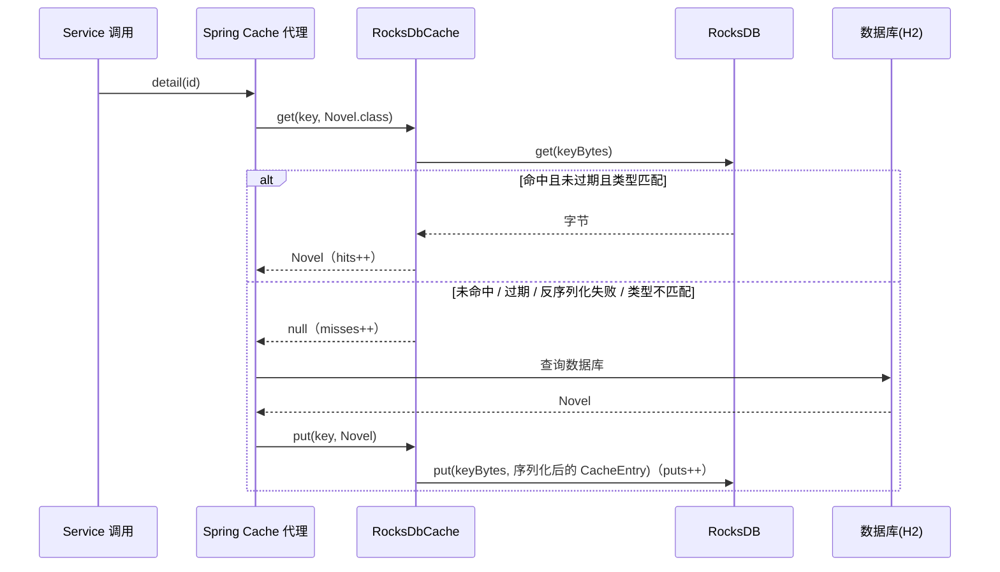

# 04 缓存设计（RocksDB）

## 1. 目标与定位

| 项 | 说明 |
| --- | --- |
| 目标 | 缓存热点只读数据（首页榜单、书目详情、章节目录、章节正文），降低 H2 查询压力 |
| 形态 | 进程内嵌式 KV 存储，无网络跳转，读取延迟在微秒级 |
| 一致性级别 | 最终一致：以 TTL 为主，写操作处辅以 `@CacheEvict` |
| 容错策略 | **可用性优先**：任何 RocksDB / 序列化异常都降级为「未命中」，不影响业务返回 |

## 2. 整体结构

```mermaid
graph TD
    A[业务 Service] -->|@Cacheable/@CacheEvict| CM[CacheManager 抽象]
    CM --> RCM[RocksDbCacheManager]
    RCM --> C1[RocksDbCache: novel-home-list]
    RCM --> C2[RocksDbCache: novel-detail]
    RCM --> C3[RocksDbCache: novel-chapter / novel-chapter-no / novel-chapter-list]
    C1 --> DB[(单个 RocksDB 实例)]
    C2 --> DB
    C3 --> DB
```

- 所有缓存共享**同一个 RocksDB 实例**，通过 `key = 缓存名 + ":" + 业务键` 前缀隔离，避免多实例带来的文件句柄与内存开销。
- 缓存名既可在配置中预声明（`rocksdb.cache.names`），也可在首次 `@Cacheable` 调用时按需创建（`getMissingCache`）。
- `CacheConfiguration` 注册 `CacheManager` Bean；若 `rocksdb.cache.enabled=false`，退化为 `NoOpCacheManager`，代码无需改动。

## 3. 数据模型

### 3.1 key 设计

| 组成 | 规则 |
| --- | --- |
| 前缀 | `缓存名:`，如 `novel-detail:` |
| 业务键 | 简单类型（String / Number / Boolean / Character）直接取 `String.valueOf`；否则 JDK 序列化后 Base64，前缀 `S:`（`SimpleKey` 等走此分支） |
| 示例 | `novel-home-list:hot`、`novel-detail:1`、`novel-chapter-no:1:3`、`novel-chapter-list:1` |

### 3.2 value 设计

value 为一个可序列化包装对象：

```text
CacheEntry { long createdAt; Object value; }   // JDK 原生序列化后的字节数组
```

- 携带写入时间，用于 TTL 判定；
- 要求被缓存对象实现 `Serializable`（`Novel` / `Chapter` / `Category` 及其集合均已实现），`List.of()` / `records` 等额外结构同理。

## 4. 缓存清单

| 缓存名 | 内容 | 键 | 失效方式 |
| --- | --- | --- | --- |
| `novel-home-list` | 热门榜、精选、最近更新、同类推荐 | `hot` / `recommend` / `latest` / `related:{novelId}:{limit}` | TTL；EPUB 上传 / 书目删除时整体 `@CacheEvict(allEntries = true)` |
| `novel-detail` | 单本书详情实体 | 书籍 id | TTL；详情页自增点击时 `@CacheEvict` |
| `novel-chapter` | 章节正文（按章节 id） | 章节 id | TTL |
| `novel-chapter-no` | 章节正文（按书籍 + 章号） | `novelId:chapterNo` | TTL |
| `novel-chapter-list` | 某本书的完整章节列表 | 书籍 id | TTL；新增章节后需由写接口清理 |

统一 TTL 由 `rocksdb.cache.ttl` 控制（默认 `10m`），暂不支持按缓存名单独设置。

## 5. 核心流程



要点：

- **过期处理**：读取时发现超 TTL 即删除该 key 并计为未命中，不留过期数据。
- **类型保护**：`get(key, Class<T>)` 若反序列化结果与期望类型不符，记录警告、删除该 key 并按未命中处理（避免实体结构变更后出现 `ClassCastException`）。
- **写失败降级**：对象不可序列化（`NotSerializableException`）时记录警告并跳过写入，业务正常返回。
- ** null 值**：不写入缓存（Spring Cache 语义下 null 表示「无值」，统一由 TTL 结束前的回源解决）。

## 6. 生命周期管理

| 阶段 | 行为 |
| --- | --- |
| 启动 | `RocksDB.loadLibrary()`；创建目录；`RocksDB.open(Options)`；`clean-on-start=true` 时遍历全库删除历史数据；按配置预建缓存对象 |
| 运行 | 读写 SSD/HDD 上的 LSM Tree；`WriteOptions.sync=false`（进程崩溃不丢数据，仅丢未刷盘的 WAL 行为差异，一般可接受） |
| 关闭 | `@PreDestroy`（`DisposableBean.destroy()`）：关闭各缓存的 `Read/WriteOptions` → `syncWal()` → `db.close()` → `options.close()`，逐个打印日志 |
| 运维 | `GET /cache` 查看命中率、写入数、条目数；`DELETE /cache/{name}` 清空指定缓存 |

配置参考：

```yaml
rocksdb:
  cache:
    enabled: true
    path: ./.rocksdb-cache
    ttl: 10m
    clean-on-start: true
    names: [novel-home-list, novel-detail, novel-chapter, novel-chapter-no, novel-chapter-list]
```

## 7. 已识别问题与风险

| 风险 | 影响 | 缓解措施 |
| --- | --- | --- |
| JDK 序列化较重，且强依赖类结构（`serialVersionUID` 变更导致反序列化失败） | 旧缓存不可读 | 已按未命中处理；生产建议换 Jackson 并显式类型，或升级时清空目录 |
| 分页查询结果（`Page`）不可序列化 | 无法直接缓存 `rankPage` / `search` 的 `Page` 对象 | 当前不缓存 `Page`；如需缓存改为缓存 `content` 列表并自行维护分页信息 |
| 嵌入式缓存无法在多实例间共享 | 多副本部署时命中率下降、数据不一致窗口变大 | 多实例场景切换 Redis（见 [05 文档](05-构建部署与配置.md)） |
| 本地写占用磁盘与内存 | 目录持续增长 | 定期清理目录 / 调整 TTL；`size()` 与命中率可通过 `/cache` 观测 |
| 首次访问仍有穿透 | 冷启动 RT 抖动 | 可在启动后做一次预热（结合后续需求实现） |

## 8. 扩展点

1. **按缓存名配置 TTL**：`RocksDbCacheProperties` 增加 `map<string, Duration>`，在 `RocksDbCacheManager` 创建缓存时按名取值。
2. **换用列族（ColumnFamily）隔离**：缓存数量或数据量增大时，用列族替代 key 前缀，便于按列族调参与 drop。
3. **替换序列化器**：抽出 `CacheSerializer` 接口，提供 JDK / Jackson 两种实现并配置选择。
4. **缓存预热与统计导出**：启动时异步回源热点数据；将 `CacheStats` 导出到 Micrometer / Actuator。
